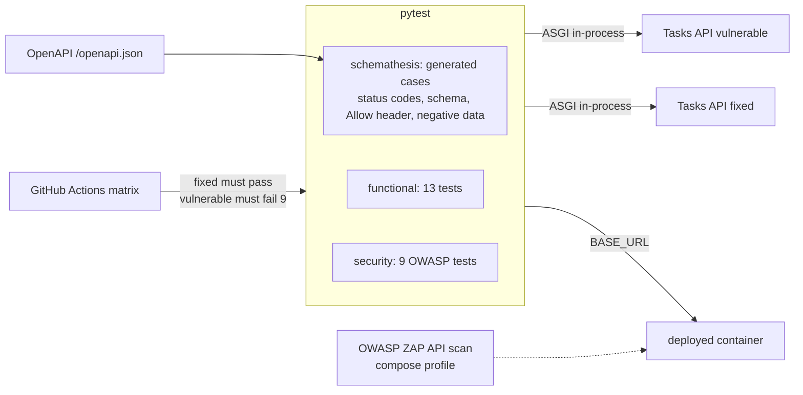

# api-qa-suite: pytest + schemathesis + OWASP API Top 10 checks

> **Lab project.** `api/app.py` is a small Tasks API I wrote as the system under test. `APP_MODE=vulnerable` ships **6 seeded defects** that mirror real OWASP API Top 10 findings. `APP_MODE=fixed` corrects them. A QA suite only has value if it **fails on the bad build and passes on the good one**, and CI asserts both.

## Problem
Typical API test suites check the happy path and some 4xx codes. They miss the bugs that matter: BOLA (reading someone else's object by changing an ID), forged tokens, leaked password hashes, mass assignment, missing rate limits and missing security headers. They also drift from the OpenAPI contract. This suite has three layers: **functional** (CRUD, auth, validation boundaries, Unicode), **security** (OWASP API Security Top 10 2023), and **contract** (schemathesis property-based fuzzing from the OpenAPI schema).

## Architecture


## Run
```bash
pip install -r requirements.txt
APP_MODE=fixed pytest -q            # 28 passed
APP_MODE=vulnerable pytest -q       # 9 failed: the seeded defects
APP_MODE=fixed ALLOW_TEST_RESET=1 uvicorn api.app:app --port 8765 &
BASE_URL=http://127.0.0.1:8765 pytest -q tests/functional tests/security
schemathesis run http://127.0.0.1:8765/openapi.json -H "Authorization: Bearer tok-admin"
docker compose up --build suite     # or: docker compose --profile zap up zap
```

## Results (actual runs, 2026-10-11, schemathesis 4.30.1)
| Target | Result | Log |
|---|---|---|
| In-process, **vulnerable** | **9 failed**, 19 passed. All 6 seeded defects caught | `results/pytest_vulnerable.log` |
| In-process, **fixed** | **28 passed** (stable over 3 repeated runs) | `results/pytest_fixed.log` |
| Live uvicorn, vulnerable (functional + security) | 6 failed, 16 passed | `results/pytest_live_vulnerable.log` |
| Live uvicorn, fixed | 22 passed | `results/pytest_live_fixed.log` |
| schemathesis CLI, live vulnerable | 2 unique failures (Allow header), 446 cases | `results/schemathesis_cli_vulnerable.log` |
| schemathesis CLI, live fixed | **534 cases generated, 534 passed** (warning: mostly 429, because the rate limiter works) | `results/schemathesis_cli_fixed.log` |

| Seeded defect | OWASP API 2023 | Caught by |
|---|---|---|
| No ownership check on `GET /tasks/{id}` | API1 BOLA | `test_API1_BOLA...` |
| Any `tok-*` token accepted | API2 Broken Authentication | `test_API2_forged_token_rejected` |
| `pw_hash` returned by `/me` | API3 Property-level auth (exposure) | `test_API3_no_sensitive_fields_exposed` |
| Client-set `owner_id` honoured | API3 Mass assignment | `test_API3_mass_assignment_owner_id` |
| No rate limit | API4 Unrestricted resource consumption | `test_API4_rate_limiting` |
| No security headers, `X-Powered-By` leak | API8 Security misconfiguration | `test_API8_security_headers` |

**Real bugs schemathesis found that I had NOT seeded**, in my "fixed" build:
1. `{"done": 0}` was accepted and coerced to `false` (Pydantic lax mode), even though the schema says boolean. Fixed with `strict=True`.
2. The `405` response's `Allow` header listed only one method, because Starlette registers one route per method. Fixed with a custom 405 handler.
3. Non-JSON bodies returned an undocumented `400`, and rate limiting returned an undocumented `429`. Both are now documented in the OpenAPI responses.
4. Live-mode tests initially failed (5) because of shared server state and the rate limiter carrying over between tests. I added a test-only reset endpoint, gated by `ALLOW_TEST_RESET=1`.

**Not run:** the Docker image, the compose stack, and the OWASP ZAP scan (Docker not run yet), and the GitHub Actions matrix.

## Limitations
- The SUT is a toy with an in-memory store. Real APIs need test-data management (factories, DB snapshots).
- Rate-limit testing is timing-based (60 requests in under 10 s). It could flake on a very slow runner.
- The OWASP coverage is 6 of 10 categories plus injection payloads. Not covered: API5 function-level auth across admin routes, API6 business flows, API7 SSRF, API9 inventory, API10 unsafe consumption.
- schemathesis with `max_examples=25` in pytest is a smoke-level fuzz. Use the CLI with higher counts in nightly runs.

## Sources
- OWASP API Security Top 10 (2023): https://owasp.org/API-Security/editions/2023/en/0x11-t10/
- Schemathesis docs: https://schemathesis.readthedocs.io/
- OWASP ZAP API scan: https://www.zaproxy.org/docs/docker/api-scan/
- Pydantic strict mode: https://docs.pydantic.dev/latest/concepts/strict_mode/
